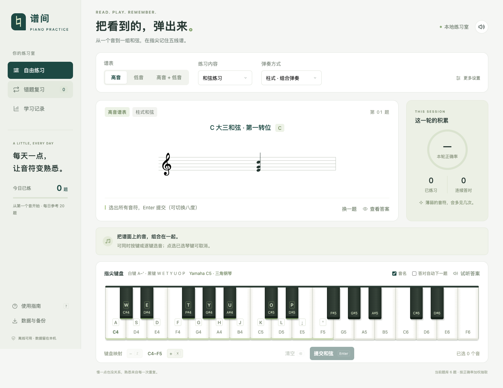

# 谱间 · 五线谱练习室

一个打开就能练的离线钢琴识谱 app。支持 Windows 和 macOS，无账户、无后端、无运行时依赖。



## 直接使用

```sh
git clone https://github.com/3365538768/staff-piano-trainer.git
```

进入文件夹，**双击 `index.html`**，在 Chrome、Edge、Safari 或 Firefox 中打开即可，不需要安装 Node.js、Python，也不需要 `npm install`。Windows 可双击 `启动练习.bat`；macOS 可双击 `启动练习.command`（如受系统限制，直接打开 `index.html`）。下载 GitHub ZIP 并解压也可以使用。

仓库默认为私有，克隆或下载时请登录有访问权限的 GitHub 账户。字体、脚本和音色均在本机，不依赖 CDN，断网可练。

若已安装 Node.js 20+，也可运行 `npm start`，打开 <http://127.0.0.1:49321>。使用固定本地地址有助于保持浏览器存储位置一致。两种打开方式的记录分别保存，可用备份互相迁移。

## 可以练什么

- **谱表**：高音、低音、高音 + 低音双谱表。双谱表单音题同时识别两手各一个音；和弦题为左手低音 + 右手和弦。
- **单音**：入门九个白键范围；进阶两个八度，可加入半音。
- **和弦**：大三、小三、增三、减三、sus2、sus4、属七、大七、小七、半减七、减七。
- **转位**：原位、第一/第二转位，七和弦还支持第三转位。例如 C4–E4–G4、E4–G4–C5、G4–C5–E5。
- **和弦名称**：题目直接显示中文名称、转位及常用符号，例如“C 大三和弦 · 第一转位”和“Cmaj7”。复习与学习记录也显示完整名称。
- **弹法**：柱式组合、上行分解、下行分解、阿尔贝蒂低音，以及随机混合。分解题按谱面从左到右依次弹奏，**不考察节奏与时值**。阿尔贝蒂三和弦采用“低–高–中–高”，重复两次；四音和弦轮换两个中间音，双谱表五音题覆盖所有中间音。
- **正确率驱动**：弱项、未练题与待复习题更常出现；有其他候选时避免连续抽到同一题。
- **错题复习**：每道错题保留完整的谱表、音高、转位和弹法，只有**连续两次正确**才移除；中途答错重新计数。普通练习中的正确也会累积。查看/试听答案和跳过按未掌握记录。
- **记录与备份**：今日题数、累计正确率、14 天练习图、薄弱题目列表，支持 JSON 导出/导入。

“仅白键”会筛掉含变化音的和弦，因此某些组合没有题目，例如三和弦的第三转位，或仅白键的减七和弦。调整变化音或和弦类型即可。

## 怎么弹

| 操作 | 按键 |
| --- | --- |
| 白键 C D E F G A B C D E F | A S D F G H J K L ; ' |
| 黑键 C♯ D♯ F♯ G♯ A♯ C♯ D♯ | W E T Y U O P |
| 降低 / 升高映射八度 | Z / X |
| 提交柱式和弦 / 答题后下一题 | Enter |
| 清空已选和弦 / 重来分解输入 | Backspace |
| 停音、清空当前输入 | Esc |
| 使用指南 | ? |

钢琴描边区域和琴键字母表示当前电脑键盘映射。音名后的数字是实际八度，中央 C 是 C4，**不同八度不会视为同一个答案**。每题自动选择映射八度，不会直接标出答案；跨八度或双手题可通过 Z/X 切换，也能直接点击全部琴键。

白键覆盖 A 到引号键，初始高音映射为 C4–F5。上排 Q 到左方括号区域按真实钢琴位置对应：**Q、R、I、[ 留空**（E–F、B–C 之间没有黑键），其余黑键按 W E T Y U O P 演奏。分号和引号优先按物理键位识别，因此中文分号、弯引号或 Shift 后的符号也能正确弹奏。

柱式和弦支持同时按键或逐键选音，选齐后按 Enter（也可点“提交和弦”）。鼠标再点已选琴键可取消，Backspace 全部清空。这兼容普通电脑键盘的按键冲突，也允许在不同八度逐键组合。分解模式则按谱面顺序逐个输入，不需要提交。电脑键盘的物理排列不能完全模拟钢琴指法。

音色使用 **Salamander Grand Piano / Yamaha C5 三角钢琴实录采样**（Alexander Holm，CC BY 3.0）。25 个立体声采样锚点覆盖 C2–C8，通过最近锚点变速覆盖各半音，保留原采样的起音与自然衰减；仅控制音量和松键收音。约 1.4 MB 音频已打包在 `assets/grand-piano.js`，无需联网或另装音源，双击 HTML 也可播放。电脑键盘使用固定力度。浏览器需要在首次点击或按键后才能发声；右上角可静音，备份弹窗中可调音量。

## 数据存在哪里

只使用浏览器 `localStorage`。练习记录不会进入 Git 仓库，不会上传服务器。移动文件夹、更换浏览器、清理浏览器数据、隐私模式或使用不同打开地址，可能导致原记录不可见；浏览器对 `file://` 存储的行为可能不同。请定期通过“数据与备份”导出 JSON，再在新电脑导入。导入会替换本机记录，操作前会确认；清空数据也会确认。

同一浏览器同一地址的窗口会同步记录；建议单窗口练习，避免多个窗口同时答题互相覆盖。

## 开发与验证

无需安装依赖，安装 Node.js 20+ 后运行：

```sh
npm test
npm start
```

`music.js` 负责拼写、真实音高、和弦转位、题库和加权抽样；`learning.js` 负责正确率、错题状态机及备份校验；`app.js` 负责谱面 SVG、交互和本地存储，`piano-audio.js` 负责采样播放与松键收音。测试覆盖所有题库组合的不变量，以及错题连续两次移除、错误重置、八度、转位、分解顺序和备份。

乐理参考：[Open Music Theory — Triads and seventh chords](https://open-musictheory.github.io/docs/fundamentals/triads/)。Bravura 字体来自 [Steinberg](https://github.com/steinbergmedia/bravura)，按 SIL Open Font License 分发，许可证在 `assets/Bravura-LICENSE.txt`。应用代码使用 MIT 许可。

钢琴采样来源：[Tone.js Salamander 音源库](https://github.com/Tonejs/audio/tree/efd8296360f9526e379bfbe5c1698ff54d6a1d34/salamander)。原作者 Alexander Holm，按 [CC BY 3.0](https://creativecommons.org/licenses/by/3.0/) 分发，授权与来源见 `assets/grand-piano-LICENSE.txt`。应用未包含完整的 16 力度层采样库；所用 MP3 选集为单力度、固定键盘力度。
